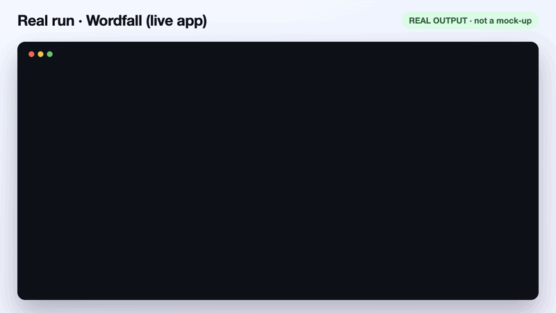

<div align="center">

# ShipPilot

**Your mobile app's build-to-growth loop, run from Claude Code.**<br>
Build → test & release → store & ad creatives → campaigns → measure → improve.
You approve every release and every ad dollar.

[](https://github.com/ufukyuksel-dev/shippilot/actions/workflows/ci.yml)
[](LICENSE)


[English](README.md) · [Türkçe](README.tr.md)


<sub>54-second motion demo · [MP4](https://github.com/ufukyuksel-dev/shippilot/releases/download/v0.3.1/demo-v3.mp4) · illustrative, with sample numbers · rendered from
[`docs/video/motion.html`](docs/video/motion.html)</sub>


</div>

## What you get

- **One loop instead of six tools.** The same Claude Code session that changes your app also ships it, writes the
  store and ad copy, reads your campaigns and checks what users did — and links the results back to the next change.
- **Approval gates where money or users are affected.** Beta uploads, store-text publishing, review submission and
  every ad change (budget, status, targeting, creation) wait for your explicit decision; ad changes go
  preview → approve → read-back.
- **Checks that run without Claude too.** The store-limit checker and the CI/CD template work in plain CI.
- **Measured, not claimed.** The growth loop states sample sizes and decision rules up front and says
  "not yet measurable" instead of declaring a win.

## See it on a real app



<sub>Real output, not a mock-up: the checker on the live app **Wordfall** (5 locales, iOS and Android) and
`fetch_listing.py` on its public App Store page · [MP4](https://github.com/ufukyuksel-dev/shippilot/releases/download/v0.3.1/real-run-v1.mp4).
Full audit generated from live store data: [docs/examples/audit-wordfall.md](docs/examples/audit-wordfall.md).</sub>

## Install

In Claude Code:

```text
/plugin marketplace add ufukyuksel-dev/shippilot
/plugin install shippilot@shippilot
```

Then, inside your app repository, start with a read-only report:

```text
/shippilot:launch-check
```

## Try it on any app

No store account, API key or Fastlane setup needed — just a public store link (yours or any other app):

```text
/shippilot:audit https://apps.apple.com/us/app/id6761381016
/shippilot:audit "https://play.google.com/store/apps/details?id=game.wordfall.app"
```

It fetches the public listing, checks lengths against the store limits, and writes a report: what the listing
promises, quick wins, iOS and Android drafts in up to five languages (each within its own limits), a screenshot
story and three ad angles. It aims to finish in about a minute. Fields the public data does not include (App Store
subtitle and keywords, the full Play description) are reported as unknown, never guessed.
[Example report](docs/examples/audit-wordfall.md).

Without the plugin, the fetcher alone gives you the raw data as JSON:

```sh
curl -fsSLO https://raw.githubusercontent.com/ufukyuksel-dev/shippilot/v0.3.1/scripts/fetch_listing.py
curl -fsSLO https://raw.githubusercontent.com/ufukyuksel-dev/shippilot/v0.3.1/scripts/check_metadata.py
python3 fetch_listing.py "https://apps.apple.com/us/app/id6761381016"
```

## The six stages

| # | Stage | What ShipPilot does | Command / skill | Works today |
|---|---|---|---|---|
| 1 | **Build** | Claude Code makes the change; `launch-check` reports what the repo still needs for releases, ads and analytics | `/shippilot:launch-check` | Yes (read-only) |
| 2 | **Test & release** | CI runs your tests and the store-limit checks; a beta build goes to TestFlight / Play internal after you approve | `/shippilot:check-metadata`, `/shippilot:beta`, [`templates/github-actions-release.yml`](templates/github-actions-release.yml), [`templates/Fastfile.example`](templates/Fastfile.example) | Yes, with your Fastlane + store credentials |
| 3 | **Store & creatives** | Localizes store text within limits; drafts ad angles, headlines, descriptions and creative briefs from what the app really does | `/shippilot:localize`, `/shippilot:ad-creatives`, `store-listing-assets` | Text: yes. Visuals: with your design/image tools |
| 4 | **Campaigns** | Reads campaigns across accounts; budget/status/targeting changes go preview → approve → read-back | `/shippilot:ads-report`, `google-ads-management`, `meta-ads-management`, `tiktok-ads-management` | With a connected ads MCP |
| 5 | **Measure** | Joins campaigns with in-app behaviour for the same cohort and window (onboarding, day-1 return, purchases) | `/shippilot:grow`, `growth-loop` | With your analytics source |
| 6 | **Improve** | One hypothesis, one change (app *or* ads), a decision rule set in advance, then re-measure — next loop starts at 1 | `/shippilot:grow` | Yes; you decide every change |

## Commands

| Command | What it does | Changes anything? |
|---|---|---|
| `/shippilot:audit <store-url>` | Audit any public App Store / Google Play listing; drafts, screenshot story, ad angles | Writes a report file |
| `/shippilot:launch-check` | Readiness report: Fastlane lanes, metadata, device QA, ads and analytics connections | No |
| `/shippilot:check-metadata` | Checks App Store / Google Play length limits | No |
| `/shippilot:beta [ios\|android\|both]` | Plans a beta upload (TestFlight / Play internal), uploads after you confirm | After approval |
| `/shippilot:localize <locales>` | Writes localized store text to `fastlane/metadata`, validates limits, shows the diff | Local files only |
| `/shippilot:ad-creatives [platforms]` | Ad angles, headlines, descriptions and creative briefs in `ads/creatives/<date>.md` | Local files only |
| `/shippilot:ads-report [period]` | Spend, installs and cost per install across connected ad accounts | No |
| `/shippilot:grow <question>` | Baseline → one hypothesis → one change → stops at the approval gate | After approval |

## CI/CD release template

[`templates/github-actions-release.yml`](templates/github-actions-release.yml) is a workflow for **your app
repository**: pull requests run your tests and the store-limit checks; pushing a `v*` tag runs the beta lanes from
[`templates/Fastfile.example`](templates/Fastfile.example) for Android and iOS.

The approval comes from GitHub, not from the file. Set it up once:

1. **Settings → Environments → New environment** `beta`.
2. **Required reviewers:** add yourself or your team. Without this rule the beta jobs run without waiting.
3. **Deployment branches and tags:** *Selected*, add the tag rule `v*`.
4. Add the store credentials as **environment secrets** of `beta` (`PLAY_SERVICE_ACCOUNT_JSON`, `ASC_API_KEY_JSON`).

Required reviewers on private repositories need a GitHub plan that supports environment protection rules.

## Skills and what they need

Skills load automatically when a task matches. A skill is knowledge and procedure; it does not grant access. When a
requirement is missing, the skill says exactly what is missing and stops at that step instead of guessing.

| Skill | Needs | If missing |
|---|---|---|
| `mobile-store-release` | Fastlane + Bundler; Xcode on macOS for iOS; App Store Connect API key and/or Play service account | Reports the missing lane, tool or credential; never prints key contents |
| `store-listing-assets` | Your existing ASO/screenshot design source; an image model for raster artwork (optional) | Works on text and inventory only |
| `mobile-ui-review` | [`adb` MCP server](https://github.com/ufukyuksel-dev/SUPER_COMPUTER_AI/tree/main/mcp/servers/adb) + an Android device or emulator | Asks you to connect the server; does not fall back to raw `adb` |
| `google-ads-management` | [`google-ads` MCP server](https://github.com/ufukyuksel-dev/SUPER_COMPUTER_AI/tree/main/mcp/servers/google-ads) with your own credentials | Read-only planning; no mutations |
| `meta-ads-management` | [Official Meta Ads MCP](https://developers.facebook.com/documentation/ads-commerce/ads-ai-connectors/ads-mcp-server/ads-mcp-server-overview) | Lists the setup steps |
| `tiktok-ads-management` | [TikTok API for Business](https://business-api.tiktok.com/portal) app, scopes and an MCP/adapter | Reports which prerequisite is missing |
| `growth-loop` | An analytics source with real events (Firebase/GA4 export, your own events table, store consoles) + optional ad data | Does the parts the data allows; never reports guesses as findings |

## Safety rules built in

- **Approval gates:** uploads, publishing store text, review submission and every ad mutation require your explicit
  decision. In CI the gate is the `beta` environment's required reviewers.
- **Beta is not metadata:** beta lanes upload binaries only. Store text changes the *live* store page and is a
  separate step.
- **Credentials stay in your control:** they live in your local environment when commands run on your machine, and
  in your CI secret store when the GitHub Actions template runs. ShipPilot checks that they exist; it never prints,
  commits or logs them.
- **Measured, not claimed:** sample sizes, windows and decision rules are stated; correlation is labelled as
  correlation.

## What ShipPilot runs and connects to

| Part | Runs / fetches | Sends |
|---|---|---|
| `scripts/check_metadata.py` | Reads your local `fastlane/metadata` files | Nothing |
| `scripts/fetch_listing.py` (used by `/shippilot:audit`) | `GET https://itunes.apple.com/lookup?id=…&country=…` or the public `https://play.google.com/store/apps/details?id=…` page | The app id and region in that request; no cookies, no account |
| `/shippilot:beta`, release skill | Your Fastlane lanes, after you approve | To Apple / Google with **your** credentials |
| Ads skills, `/shippilot:ads-report` | The ads MCP servers **you** connect | To those ad platforms with **your** credentials; mutations only after approval |
| `/shippilot:grow` | Your analytics source | Reads only |
| `docs/make_demo.py` | Maintainer tool for the README media (Playwright + ffmpeg); not used by the plugin | Nothing |

No telemetry, no analytics, no server of ours. See [PRIVACY.md](PRIVACY.md).

## Metadata checker

Also usable without Claude, in CI or a pre-commit hook (Python 3.9+, no dependencies):

```sh
python3 scripts/check_metadata.py --platform ios     --metadata fastlane/metadata
python3 scripts/check_metadata.py --platform android --metadata fastlane/metadata/android
```

| Platform | Field (file) | Limit |
|---|---|---|
| iOS | `name`, `subtitle` | 30 characters |
| iOS | `keywords` | 100 **bytes** (UTF-8) |
| iOS | `promotional_text` | 170 characters |
| iOS | `description`, `release_notes` | 4000 characters |
| Android | `title` | 30 characters |
| Android | `short_description` | 80 characters |
| Android | `full_description` | 4000 characters |
| Android | `changelogs/*.txt` | 500 characters |

Exit code `0` = within limits, `1` = violations, `2` = nothing was checked (missing directory, no locale, no
recognised file) — an empty run never passes silently. Limits are from Apple's
[App Store Connect reference](https://developer.apple.com/help/app-store-connect/reference/app-information/platform-version-information)
and Google's [Play Console help](https://support.google.com/googleplay/android-developer/answer/9859152).

## Status

**v0.3 — early.** What exists today: the skills, eight commands, the store metadata checker and listing fetcher
with tests, the Fastlane and GitHub Actions templates. What does not exist yet: a hosted service, automatic attribution between ad platforms
and in-app analytics, or any autonomous spending. Feedback from people shipping real apps decides what comes next.

See [ROADMAP.md](ROADMAP.md). Questions and ideas: [Discussions](https://github.com/ufukyuksel-dev/shippilot/discussions).

## Built with ShipPilot

Shipped or grew an app with the plugin? [Tell us](https://github.com/ufukyuksel-dev/shippilot/issues/new?template=release-story.yml)
and it can be listed here.

## Why we built it

We are a small studio. Our word game **Wordfall** was built and shipped to the App Store and Google Play with Claude
Code and the internal workflows ShipPilot is based on. ShipPilot is those workflows, cleaned of our private setup and
published so anyone can use them.

## How this repository is built

The skills in [`skills/`](skills) are generated, not hand-edited here. Their single source is
[SUPER_COMPUTER_AI](https://github.com/ufukyuksel-dev/SUPER_COMPUTER_AI), where project-specific content is marked
private and removed by `scripts/export_plugin.py`, which also refuses to export home paths, secret-like strings or
denied project names. Commands, the checker, templates and docs live here. See [CONTRIBUTING.md](CONTRIBUTING.md).

## Trademarks

App Store, App Store Connect and TestFlight are trademarks of Apple Inc.; Google Play is a trademark of Google LLC;
Meta and Instagram are trademarks of Meta Platforms, Inc.; TikTok is a trademark of ByteDance Ltd. The store and ad
screens in the demo are simplified re-drawings. ShipPilot is not affiliated with or endorsed by these companies.
In the demo, Claude Code builds the app from the idea; ShipPilot covers releasing, campaigns, measuring and
improving it.

## Community

[Contributing](CONTRIBUTING.md) · [Code of Conduct](CODE_OF_CONDUCT.md) · [Security](SECURITY.md) · [Privacy](PRIVACY.md) ·
[Roadmap](ROADMAP.md) · [Discussions](https://github.com/ufukyuksel-dev/shippilot/discussions)

## License

[MIT](LICENSE) © MB Worldwide Apps · [mbworldwideapps.com](https://mbworldwideapps.com)
