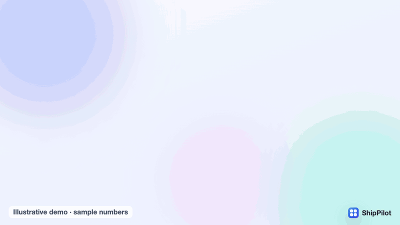
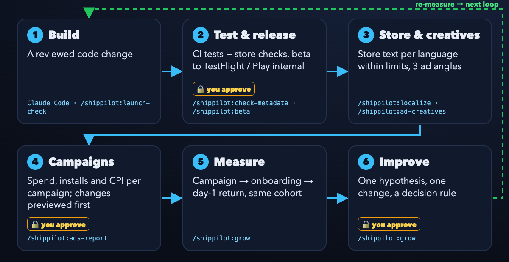

<div align="center">

# ShipPilot

**Mobil uygulamanın geliştirmeden büyümeye kadar tüm döngüsü, Claude Code içinden.**<br>
Geliştir → test et ve yayımla → mağaza ve reklam kreatifleri → kampanyalar → ölç → iyileştir.
Her yayını ve harcanan her reklam dolarını sen onaylarsın.

[](https://github.com/ufukyuksel-dev/shippilot/actions/workflows/ci.yml)
[](LICENSE)

[English](README.md) · [Türkçe](README.tr.md)



<sub>54 saniyelik motion demo · [MP4](docs/assets/demo-v3.mp4) · temsilî, örnek sayılarla</sub>



</div>

## Ne kazanırsın

- **Altı ayrı araç yerine tek döngü.** Uygulamayı değiştiren Claude Code oturumu aynı zamanda şunları yapar:
  - uygulamayı yayımlar,
  - mağaza ve reklam metnini yazar,
  - kampanyaları okur,
  - kullanıcıların ne yaptığını kontrol eder.

  Sonuçlar bir sonraki değişikliğe bağlanır.
- **Para ya da kullanıcı etkilendiğinde onay kapısı.** Şu adımların hepsi senin açık kararını bekler:
  - beta yükleme,
  - mağaza metninin yayımlanması,
  - incelemeye gönderme,
  - her reklam değişikliği.

  Reklam değişiklikleri önce önizlenir, sonra onaylanır, ardından sonuç yeniden okunarak doğrulanır.
- **Claude olmadan da çalışan kontroller.** Mağaza sınırı kontrolcüsü ve CI/CD şablonu düz CI'da da çalışır.
- **İddia değil ölçüm.** Büyüme döngüsü örneklem büyüklüğünü ve karar kuralını baştan söyler. Kazanım ilan etmek
  yerine gerektiğinde "henüz ölçülemez" der.

## Kurulum

Claude Code içinde:

```text
/plugin marketplace add ufukyuksel-dev/shippilot
/plugin install shippilot@shippilot
```

Ardından uygulamanın repo'sunda, hiçbir şeyi değiştirmeyen bir raporla başla:

```text
/shippilot:launch-check
```

## Altı aşama

| # | Aşama | ShipPilot ne yapar | Komut / skill | Bugün çalışıyor mu |
|---|---|---|---|---|
| 1 | **Geliştir** | Claude Code değişikliği yapar; `launch-check` repo'da eksik olanları raporlar | `/shippilot:launch-check` | Evet (salt okunur) |
| 2 | **Test et ve yayımla** | CI testleri ve mağaza sınırı kontrolünü çalıştırır; beta build onaydan sonra TestFlight / Play internal'a gider | `/shippilot:check-metadata`, `/shippilot:beta`, [CI şablonu](templates/github-actions-release.yml) | Evet, Fastlane ve mağaza kimlik bilgilerinle |
| 3 | **Mağaza ve kreatif** | Mağaza metnini sınırlar içinde çevirir; uygulamanın gerçekte yaptığından reklam açıları, başlıklar ve brief'ler hazırlar | `/shippilot:localize`, `/shippilot:ad-creatives` | Metin: evet. Görsel: senin tasarım araçlarınla |
| 4 | **Kampanyalar** | Hesapları okur; bütçe, durum ve hedefleme değişiklikleri önce önizlenir, onaylanır ve sonuç yeniden okunur | `/shippilot:ads-report` + reklam skill'leri | Reklam MCP'si bağlıysa |
| 5 | **Ölç** | Aynı kohort ve aynı zaman penceresinde kampanya verisini uygulama içi davranışla birleştirir | `/shippilot:grow` | Analitik kaynağın varsa |
| 6 | **İyileştir** | Tek hipotez, tek değişiklik, önceden belirlenmiş karar kuralı, ardından yeniden ölçüm | `/shippilot:grow` | Evet; her kararı sen verirsin |

## CI/CD şablonu: onay nasıl kurulur

[`templates/github-actions-release.yml`](templates/github-actions-release.yml) senin uygulama repo'n için hazırlanmış
bir iş akışıdır. Onayı dosyanın kendisi sağlamaz, GitHub sağlar. Bir kez şöyle kur:

1. Settings → Environments altında `beta` adında bir ortam oluştur.
2. **Required reviewers** listesine kendini ekle.
3. Deployment etiketlerine `v*` kuralını ekle.
4. Mağaza kimlik bilgilerini bu ortamın secret'ları olarak ekle.

**Required reviewers** kuralı yoksa beta job'ları onay beklemeden çalışır.

**Kimlik bilgileri:** Komutlar senin makinende çalışırken senin yerel ortamında, şablon çalışırken CI secret
store'unda durur. ShipPilot bunları yazdırmaz, commit etmez ve loglamaz.

Komut listesi, skill gereksinimleri ve metadata sınır tablosu için [İngilizce README](README.md)'ye bak.

## Markalar

App Store, App Store Connect ve TestFlight Apple Inc.'in; Google Play Google LLC'nin; Meta ve Instagram Meta
Platforms, Inc.'in; TikTok ise ByteDance Ltd.'nin markalarıdır. Demodaki mağaza ve reklam ekranları sadeleştirilmiş
yeniden çizimlerdir. ShipPilot bu şirketlerle bağlantılı değildir ve onlar tarafından desteklenmemektedir. Demoda
fikirden uygulamayı Claude Code üretir. Yayın, kampanya, ölçüm ve iyileştirme adımlarını ShipPilot üstlenir.

## Lisans

[MIT](LICENSE) © MB Worldwide Apps · [mbworldwideapps.com](https://mbworldwideapps.com)
