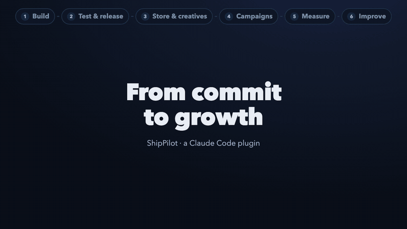
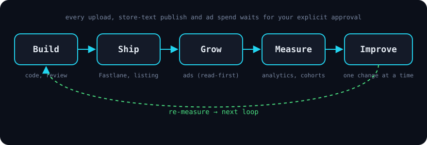

<div align="center">

# ShipPilot

**Mobil uygulamanı Claude Code ile geliştir, yayımla, büyüt.**

Bir mobil uygulamanın yayın ve büyüme işlerini kendi repo'ndan çalıştırabileceğin skill ve komutlara dönüştüren bir
Claude Code plugin'i. Kapsadığı işler: Fastlane ile yayın, mağaza sayfası, Android cihaz testi, Google / Meta /
TikTok reklamları ve ölçerek ilerleyen büyüme döngüsü. Riskli her adım senin açık onayını bekler.

[](https://github.com/ufukyuksel-dev/shippilot/actions/workflows/ci.yml)
[](LICENSE)

[English](README.md) · [Türkçe](README.tr.md)



<sub>28 saniyelik demo · [MP4](docs/assets/demo.mp4) · terminal sahneleri gerçek çıktıdır</sub>

</div>

## Neden

Artık uygulamayı yazmak işin zor kısmı değil. Asıl haftalar şuralarda kayboluyor:
- imzalama, TestFlight ve Play kanalları,
- her karakter sınırına uyan on dilde mağaza metni,
- gerçek cihazda test,
- reklam bütçesini dikkatli harcamak,
- kullanıcıların *neden* ayrıldığını bulmak.

Biz küçük bir stüdyoyuz. Kelime oyunumuz **Wordfall**'u bu iş akışları ve Claude Code ile App Store'a ve Google
Play'e çıkardık. ShipPilot, bu iş akışlarının özel ayarlarımızdan arındırılmış ve herkesin kullanımına açılmış
hâli.

## Döngü



ShipPilot paranı harcayan bir otopilot değil. Claude okur, kontrol eder, taslak hazırlar. Her yüklemeyi, mağaza
metninin yayımlanmasını ve her reklam değişikliğini **sen** onaylarsın.

## Kurulum

Claude Code içinde:

```text
/plugin marketplace add ufukyuksel-dev/shippilot
/plugin install shippilot@shippilot
```

Ardından uygulamanın repo'sunda:

```text
/shippilot:launch-check
```

## Komutlar

| Komut | Ne yapar | Bir şey değiştirir mi? |
|---|---|---|
| `/shippilot:launch-check` | Hazırlık raporu: Fastlane, metadata, cihaz testi, reklam ve analitik bağlantıları | Hayır |
| `/shippilot:localize <diller>` | Çevrilmiş mağaza metnini `fastlane/metadata` altına yazar, sınırları kontrol eder, diff gösterir | Yalnızca yerel dosyalar |
| `/shippilot:check-metadata` | App Store / Google Play karakter sınırlarını kontrol eder | Hayır |
| `/shippilot:beta [ios\|android\|both]` | Beta yüklemesini planlar, onayından sonra TestFlight / Play internal'a yükler | Onaydan sonra |
| `/shippilot:ads-report [dönem]` | Bağlı reklam hesaplarında harcama, yükleme ve yükleme başı maliyet | Hayır |
| `/shippilot:grow <soru>` | Mevcut durumu ölçer → tek hipotez → tek değişiklik → onay kapısında durur | Onaydan sonra |

Skill'lerin neye ihtiyaç duyduğu, güvenlik kuralları ve metadata kontrolcüsünün sınır tablosu için
[İngilizce README](README.md#skills-and-what-they-need)'ye bak.

## Durum

**v0.1, erken sürüm.**
- **Bugün var olanlar:** skill'ler, komutlar, metadata kontrolcüsü ve testleri.
- **Henüz olmayanlar:** barındırılan bir servis, reklam platformlarıyla uygulama içi analitiğin otomatik
  eşleştirilmesi ve otonom harcama.

Sırada ne olacağını gerçek uygulama yayımlayan kullanıcıların geri bildirimi belirleyecek.

## Lisans

[MIT](LICENSE) © MB Worldwide Apps · [mbworldwideapps.com](https://mbworldwideapps.com)
